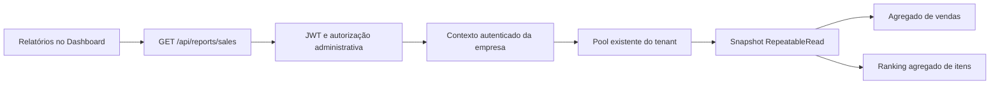

# Evolução do PDV TelTech: arquitetura, sequência e primeira entrega

Data: 19/10/2026, com atualização local dos contêineres em 20/10/2026. Base inicial: `41f5149` (`versao multiempresa`).
Escopo: análise estática dos principais módulos e fluxos, seguida de implementação local incremental. Não constitui auditoria de todas as linhas do repositório nem homologação da versão inteira para produção.

## Incremento 2 — evolução diária e comparação, implementado localmente

Após a autorização para prosseguir, a etapa 2 começou por séries diárias e comparação de períodos. O endpoint existente ganhou os campos aditivos `daily`, `comparison` e `period.includesOpenDays`. Os demais campos e permissões foram preservados. Meios de pagamento, categorias e paginação continuam como próximos incrementos dessa etapa.

- Série do período selecionado, com todos os dias em ordem e zeros para dias sem vendas registradas. Máximo de 92 registros na resposta.
- Comparação com os N dias corridos imediatamente anteriores, sem sobreposição. Não é comparação por mesmos dias da semana nem corte no mesmo horário.
- Exibe total vendido, número de vendas e ticket do período anterior; diferença monetária e percentual do total vendido. Base anterior zero ou negativa retorna percentual `null`, sem crescimento artificial ou divisão por zero.
- Intervalos que incluam dias ainda não encerrados ou futuros recebem sinalização de comparação parcial. A leitura continua usando o estado atual dos registros, inclusive cancelamentos posteriores.
- O gráfico de barras reutiliza Recharts, já instalado; uma tabela expansível fornece datas, quantidades e valores exatos. Nenhuma nova dependência.
- Uma terceira consulta, SQL parametrizado por Prisma.sql, agrega os dois períodos por dia na mesma transação RepeatableRead. O predicado filtra createdAt diretamente, permitindo uso de índice; a conversão UTC−03 acontece na projeção. Retorna no máximo 184 agregados diários, sem carregar vendas individuais ou consultar uma vez por dia.
- Frontend tolera a ausência dos novos campos, preservando a primeira tela durante uma implantação parcial.

Validação desta continuação: 6 suítes / 60 testes Jest aprovados; build backend e frontend aprovados; serviço real em MySQL temporário confirmou fronteiras UTC−03, preenchimento de dias vazios e reconciliação entre série e total. Testes Edge/Chromium em 360/768/1440 px abrangem gráfico, tabela, intervalo de 92 dias, aviso de parcialidade e base zero, além das regressões anteriores. Sem migração, alteração em banco de cliente ou deploy. Os avisos preexistentes de build permanecem. Desempenho com dados representativos continua pendente de homologação.

## 1. Decisão técnica

Criar `ReportsModule` no monólito NestJS e `/dashboard/reports` na aplicação React existente. Relatórios são um modelo de leitura sobre os registros operacionais: não devem acionar fechamento de venda, recálculo fiscal, consumo de estoque, geração de despesas ou sincronização externa.

O primeiro incremento consulta vendas concluídas e subtotais históricos de produtos. Analytics continua com seu contrato atual. Não se introduziu outro serviço, banco, biblioteca, camada de repositório genérica ou esquema paralelo de autenticação.

O módulo pode evoluir por casos de uso: vendas, produtos, custos históricos, despesas e recebíveis. Subdividir serviços quando cada área efetivamente existir; evitar um serviço único com toda a lógica financeira. Consolidado entre empresas deve permanecer distinto do relatório da empresa autenticada.

## 2. Mapa da arquitetura existente

| Camada / módulo | Estrutura e comportamento observado | Impacto na evolução |
|---|---|---|
| Aplicação web | React 19, Vite 8, React Router, Tailwind, Zustand, Axios. `main.tsx` é a entrada ativa; coexistem `pages/` e `app/`. | Preservar essa organização híbrida. Não tratar `app/` como roteamento Next.js. |
| Layout administrativo | `DashboardLayout` centraliza navegação desktop e gaveta mobile; `BottomNavigation` oferece atalhos e menu Mais. | Relatórios usa o mesmo layout e ambos os menus. Página carregada por importação dinâmica. |
| Sessão e operação | JWT da loja, credencial do operador/PIN e sessões restritas de estação. `AdminRoute` também aceita estoquista. | Um link oculto não protege dados: verificar admin/superadmin no novo endpoint e na página. |
| API | NestJS 11, prefixo `/api`, módulos por domínio. `app.module.ts` compõe domínios e tarefas agendadas. | Registrar módulo aditivo; não inicializar aplicação completa em testes que possam executar tarefas reais. |
| Dados centrais | Heart armazena tenants, usuários e configuração; `TenantInterceptor` resolve a conexão da empresa autenticada. | Não aceitar tenant/databaseUrl do filtro de relatório. |
| Dados operacionais | Prisma 6 / MySQL por tenant. Contexto em AsyncLocalStorage e conexões reutilizadas por `TenantConnectionManager`. | Reutilizar contexto e pool; não abrir uma conexão por gráfico ou por relatório. |
| Venda e caixa | Checkout, pagamentos, itens e snapshots; caixa/operador; contingência e validação de snapshot de comanda. | Relatórios lê os registros persistidos. Venda offline ainda não sincronizada não integra a consulta do servidor. |
| Produtos e estoque | Cadastro, categorias, movimentos, lotes FIFO, validade, fornecedores e pedidos de compra. | Não usar o custo atual do cadastro para reconstituir custos de vendas antigas. |
| Compostos/comandas | Componentes, modificadores, consumo de estoque e custeio têm caminhos específicos. KDS e garçom são fluxos operacionais próprios. | Não simplificar combo alterando baixa de estoque sem testar venda, cancelamento e fechamento de comanda. |
| Financeiro | Contas a pagar fixas/variáveis, recorrência, vencimento e pagamento. | Vencimento, pagamento e competência não são equivalentes. Falta definir o regime de uma futura DRE. |
| Fiscal | Módulos Nest de tributação, NFC-e e fiscal; serviço PHP separado; importação XML em etapas. | Não inferir lucro fiscal a partir da venda bruta; preservar contratos e snapshots. |
| Integrações | API e `integrations-hub` separado, polling iFood; estrutura de delivery/outbox, com processamento de delivery pausado no serviço examinado. | Consulta não reativa cron, retransmite pedido ou nota, nem altera jobs. |
| Portal do Grupo | Agregação multiempresa, catálogo/sincronização, entrada e transferências entre bancos. | Domínio de risco próprio. Não reutilizar suas escritas como infraestrutura do relatório. |
| PWA / offline | Dexie e caches operacionais; Workbox com estratégias explícitas. | API de relatórios não adicionada ao cache offline. Falha de rede aparece como falha, não como confirmação de dados atuais. |
| Operação | Docker, proxy, backups, uploads e Sys-Init. | Relatórios não altera deploy, armazenamento, certificados, rotinas de backup ou atualização de tenants. |

Fluxo de leitura implementado:

## 3. Achados e prioridades

### Base gerencial já existente

O `DashboardService` já contém indicadores por período, séries e produtos. Também existem snapshots `SaleItem.priceCost`, consumo por lote, recorrência de despesas e produtos compostos. A evolução deve aproveitar os dados existentes antes de criar estruturas novas.

A nova consulta não reutiliza integralmente `DashboardService.getSummary`: esse método carrega vendas/itens do intervalo em memória, combina caixas e alertas e possui classificações específicas de meios de pagamento. Alterar seu comportamento agora ampliaria a superfície de regressão. O novo serviço utiliza diretamente os agregados Prisma, sem duplicar checkout ou regras de escrita. Uma futura convergência dos indicadores deve ter testes de compatibilidade do contrato antigo.

### Inconsistências a resolver antes de ampliar indicadores

| Prioridade | Evidência | Tratamento |
|---|---|---|
| Alta | Soma de subtotais dos produtos não implica total líquido de vendas após desconto/acréscimo geral. | Na primeira entrega, nomes explícitos e nenhuma distribuição arbitrária. Definir rateio para margem por produto. |
| Alta | Custo histórico existe, mas zero pode representar gratuidade real ou falta de informação; compostos têm caminhos próprios. | Auditar cobertura/origem antes de publicar CMV e margens como confiáveis. Não preencher retroativamente usando preço atual. |
| Alta | Taxas históricas/adquirente/liquidação não estão representadas como um modelo completo de recebíveis. | Definir regra e snapshot por pagamento antes de exibir líquido a receber. |
| Alta | `payables` calculava `breakEvenPoint = totalToPay`. | Corrigida apenas a apresentação para “Vendas e contas do período”. Campos legados preservados. |
| Média | Dashboard classifica meios por texto e usa crédito como fallback; customizados podem cair no grupo errado. | Corrigir em etapa específica com contratos/fixtures de meios antigos e atuais; não transportar essa classificação para Relatórios. |
| Média | Comparativo semanal e fuso no Dashboard usam caminhos diferentes; semana atual pode ser parcial. | Novo relatório usa período explícito e fim exclusivo. Comparativos futuros precisam definir janela equivalente e sinalizar parcialidade. |
| Alta, preexistente | `docs/group-portal-release-validation.md` registra duplicação de transferências, alteração de custo de lotes e perda de configuração de compostos na sincronização. | Bloqueios da validação de 10/10 não foram reexecutados nem resolvidos nesta entrega. Exigem frente separada antes de liberar o portal. |
| Média | Bundle principal permanece grande; build também alerta import estático/dinâmico de xlsx. | Página nova usa lazy loading. Otimização global deve ser medida e separada, sem refatorar o PDV nesta entrega. |

## 4. Sequência recomendada e critérios de passagem

| Etapa | Escopo | Dependência / critério para avançar | Risco |
|---|---|---|---|
| 1 — fundação, implementada localmente | Módulo exclusivo; vendas concluídas, ticket, descontos/acréscimos gerais e ranking de subtotais; autorização; testes. | Homologar consulta e desempenho em base representativa antes de deploy. | Baixo: leitura; sem migração. |
| 2 — ampliar vendas/produtos | Evolução diária, comparação equivalente, meios de pagamento, categorias e ranking paginado. | Reconciliar total vs itens/pagamentos/troco; decidir categoria histórica vs atual; medir plano de execução. | Médio: semântica e volume. |
| 3 — CMV e margem bruta | Custos dos snapshots e indicadores de cobertura/confiabilidade; simples e compostos. | Fixtures de custo zero/ausente, FIFO incompleto, desconto, cancelamento e alterações posteriores. Definir rateio com arredondamento determinístico. | Médio/alto: credibilidade financeira. |
| 4 — taxas e recebíveis | Taxas por forma/adquirente/parcelas, snapshot imutável no pagamento, bruto/taxa/líquido previsto. | Definir vigência, antecipação, arredondamento, estorno e tratamento do histórico sem taxa; rollout aditivo e compatível. | Alto: toca checkout e schema. |
| 5 — despesas e resultado | Despesas por regime definido; contribuição e resultado estimado com cobertura explícita. | Definir competência vs caixa, tributos, compras vs CMV e evitar dupla contagem. | Alto: regra de negócio ainda aberta. |
| Frente independente — combos | Cadastro simplificado sobre composição existente, se os invariantes operacionais e fiscais forem atendidos. | Definir combo virtual vs kit físico, substituições, distribuição de preço, representação fiscal e devolução. | Alto: estoque/fiscal. |
| Frente independente — portal | Idempotência, recuperação de operações, custos FIFO e compatibilidade de sincronização. | Reexecutar e resolver os bloqueios documentados com testes reais de falha/retentativa. | Alto: operações entre bancos. |

Relatórios futuros podem ganhar abas Vendas, Produtos, Financeiro, Rentabilidade e Estoque à medida que estiverem funcionais. A primeira tela não apresenta abas vazias nem indicadores financeiros sem dados suficientes. Funcionalidades de delivery avançado e chat com IA não são dependências dessa sequência.

## 5. Contrato da primeira entrega

`GET /api/reports/sales?startDate=2026-10-01&endDate=2026-10-19`

- JWT obrigatório; somente `admin` e `superadmin`. Isolamento obtido do contexto autenticado, nunca de parâmetro do cliente.
- Datas obrigatórias, calendário válido, formato `YYYY-MM-DD`, início não posterior ao fim, máximo de 92 dias inclusivos.
- Dia comercial fixo UTC−03:00, consistente com o recorte atual do PDV. Não implementa conversão de horário de verão histórico; importações de dados anteriores ao fim do horário de verão exigem revisão específica.
- Janela `[início às 03:00 UTC, dia posterior ao fim às 03:00 UTC)`, preservando o último milissegundo do período.
- `status = completed`, excluindo `source = ajuste_fiscal`. Cancelados e estados pendentes ficam de fora. Isso é explícito e pode diferir de relatórios legados que apenas excluem cancelados.
- Datas referem-se à criação da venda registrada. Não há histórico temporal de status: cancelamento posterior remove a venda de uma nova consulta do período antigo. Não é uma reconstrução contábil “como estava naquele dia”.
- Totais monetários em strings decimais com duas casas; quantidade com três; ticket arredondado após dividir total pela contagem.
- Na fundação eram duas consultas agregadas; o incremento 2 acrescentou a série diária, totalizando três leituras na mesma transação RepeatableRead. Nenhuma venda individual carregada para somar em JavaScript; nenhuma união de itens e pagamentos multiplicando totais.
- Ranking limitado a 20 combinações produto/nome/unidade históricos, ordenado por subtotal com desempate determinístico. Não representa catálogo completo nem ranking de unidades entre medidas incompatíveis. Nomes alterados podem produzir mais de uma linha do mesmo produto.
- Descontos e acréscimos exibidos são os campos gerais da venda. Não são apresentados como soma de todos os descontos individuais de itens. O ranking não faz rateio desses campos.
- Dados consultados sob demanda, sem polling e sem cache offline. Erros têm retry; alteração de filtro cancela resposta obsoleta; mudança de empresa/usuário reinicializa a página.

## 6. Validação e limites

- Build NestJS e typecheck/build frontend.
- Jest: datas inválidas, anos bissextos, fronteiras, limite de 92 dias, decimais, vazio, contexto ausente e filtros; HTTP com JWT/guard/interceptor reais e persistência simulada; tenants concorrentes e tentativa de escolher tenant por query.
- Regressão direcionada: autorização operacional HTTP, snapshots de comanda e recorrência de despesas.
- `scripts/reports-mysql.cjs`: serviço real e Prisma real sobre duas bases MySQL temporárias exclusivamente de QA. Fixtures SQL mínimas, sem `prisma migrate`/`db push`; cancelamentos, ajuste fiscal, pendências, bordas de milissegundos, nomes históricos, decimais, isolamento, ranking e leitura sem modificação. Remove somente as bases criadas pelo próprio teste.
- `frontend/scripts/reports-ui-test.cjs`: Edge/Chromium com APIs simuladas, conteúdo, período inválido, falha/retry, vazio, respostas fora de ordem, menu mobile e overflow em 360/768/1440 px.

Resultado local: **5 suítes / 52 testes Jest aprovados**, cenários MySQL aprovados e interface aprovada nas três larguras, incluindo acesso ao ranking por rolagem. Capturas desktop e mobile inspecionadas. Builds aprovados; permanecem avisos de bundle principal grande, importação de xlsx e base Browserslist antiga. `git diff --check` sem erros. Resposta do relatório usa `Cache-Control: private, no-store`.

Reprodução: em `backend`, executar `npm run build` e `npm test -- --runInBand reports station-access.http.spec.ts comanda-snapshot.spec.ts payable-recurrence.spec.ts`; na raiz, `node scripts/reports-mysql.cjs` requer o MySQL Docker local configurado na porta 3308. Em `frontend`, executar `npm run build`; para UI, iniciar Vite em 127.0.0.1:4186 e executar `node scripts/reports-ui-test.cjs`, com `PLAYWRIGHT_MODULE` apontando à instalação disponível se necessário. O teste UI intercepta todas as APIs. Não executar o script de QA contra infraestrutura remota.

## Base anual sintética para avaliação visual — 20/10/2026

O tenant local `central_bebidas`, vinculado a uma conta administrativa ativa, recebeu uma carga identificável gerada por `scripts/seed-central-bebidas-year.cjs`. O script recusa bancos/portas diferentes de `central_bebidas` no MySQL Docker local publicado em 3308 e exige `--apply`. IDs começam por `qa-year-`; uma repetição remove e recria somente essa carga. `--clean` remove apenas vendas e lotes com esse prefixo.

Antes da escrita foi criado um dump local ignorado pelo Git em `backups/central_bebidas_before_synthetic_20261020_001646.sql` (743.108 bytes). A carga cobre 20/10/2025 a 19/10/2026: 6.556 vendas (6.406 concluídas e 150 canceladas), 13.098 itens, 6.540 pagamentos, 780 lotes históricos e 12.802 consumos de lote. Foram usados 60 produtos ativos já cadastrados; custo e estoque atuais não foram atualizados. Os lotes sintéticos estão totalmente consumidos e os itens preservam o custo mensal histórico.

O gerador é determinístico e inclui variação por dia da semana, sazonalidade, datas de pico, produtos em destaque por mês, quantidades, preços históricos, descontos, acréscimos, cancelamentos, pagamentos simples/divididos e dinheiro/PIX/débito/crédito. Abrange 13 competências mensais parciais/completas dentro dos 365 dias; todos os 60 produtos têm custos distintos por competência, com variação média observada de 22,24%, e 12 produtos diferentes lideraram faturamento mensal.

Validação pós-carga: zero divergências entre venda e itens, venda e pagamentos, lote e consumos; zero vínculos órfãos. As 20 vendas preexistentes permaneceram fora do prefixo. O endpoint autenticado real foi consultado de 01/07/2026 a 30/09/2026 e retornou 92 pontos diários, 1.493 vendas, R$ 36.198,60, ticket R$ 24,25, 20 produtos e comparação anterior de R$ 34.137,85. Nenhuma migração ou atualização via Sys-Init.

Esses testes não medem volume real de produção, Safari físico, migração de tenants ou comunicação completa via proxy de produção. O limite de dias e linhas reduz trabalho e resposta, mas não garante tempo máximo da consulta em bancos muito grandes. Antes do deploy, medir plano e duração das consultas em cópia representativa e monitorar latência/erros e impacto no pool. Não acrescentar índice sem essa evidência.

## 7. Implantação, reversão e integridade

Nenhum schema Prisma foi alterado. Nenhum banco de cliente foi migrado. Não é necessário acionar “Atualizar Bancos” para esta entrega. Para fases futuras com schema, `.agents/AGENTS.md` exige atualização exclusivamente pelo usuário via Sys-Init; nunca executar migração/push direto contra tenants.

Publicar backend antes do frontend e validar permissões com admin e perfis restritos; validar total de um dia conhecido, dia vazio e ranking na homologação. Preservar o processo existente de deploy e PWA. Em 20/10/2026, as imagens Docker locais de backend e frontend foram reconstruídas e os dois contêineres recriados para disponibilizar a tela no ambiente local. Isso não é publicação em produção e não autoriza afirmar que o módulo está disponível aos clientes.

Rollback: restaurar os artefatos anteriores do frontend e backend. Não há migração de reversão nem dados gerados pelo relatório para apagar. Se somente o backend for revertido, o frontend novo mostrará erro na consulta; preferir reverter frontend primeiro. A liberação deste incremento não deve ser confundida com aprovação de todas as alterações já presentes na branch, especialmente o Portal do Grupo.

## 8. Decisões de negócio pendentes

Antes de tocar nas respectivas etapas: taxa prevista versus efetiva; parcelamento e antecipação; vigência de taxas; critério de rateio de descontos; custo desconhecido versus zero legítimo; despesas por competência versus pagamento; devoluções parciais; kit físico versus combo virtual e tratamento fiscal. Nenhuma dessas regras foi arbitrariamente implementada nesta primeira entrega.
